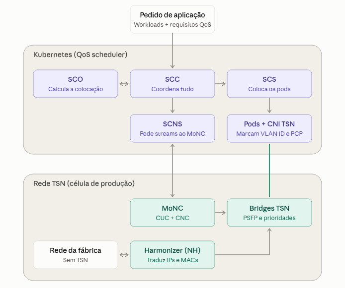

# FabOS: Hooking up Container Platforms with Time-Sensitive Networks

## O problema

As fábricas do futuro têm de ser muito mais adaptáveis. O layout da produção pode mudar diariamente, e os PLCs virtuais passam a correr em hardware comum. Faz sentido usar plataformas de contentores como o Kubernetes (K8s), mas estas foram pensadas para a TI e ignoram os requisitos de rede em tempo real da indústria. O TSN (Time-Sensitive Networking) é o sucessor aberto dos protocolos industriais proprietários, mas a combinação K8s + TSN estava praticamente por explorar.

Os autores identificam quatro lacunas:

1. Ligar células de produção com acesso de camada 2 e pouca configuração.
2. Dar aos pods acesso a funcionalidades TSN (por exemplo, tags VLAN), que se perdem com o encaminhamento IP.
3. Criar uma interface entre o K8s e o controlador da rede TSN.
4. Tornar o escalonamento do K8s consciente da rede: hoje considera CPU e RAM, mas não largura de banda nem latência.

## A solução: FabOS Seamless Compute Cluster (FSCC)

**Network Harmonizer (NH)**: um componente semelhante a um router, mas transparente em camada 2. Traduz endereços IP (e MAC, se necessário) entre a rede da fábrica e a da célula. Assim, células de fornecedores diferentes podem ter endereços sobrepostos sem conflito.
**Modular Network Controller (MoNC)**: implementa o modelo centralizado do IEEE 802.1Qcc. Recolhe os requisitos dos streams, descobre a topologia por LLDP, calcula a configuração (prioridade, PSFP, taxas) e configura as bridges por SSH/NetConf.
**QoS Scheduler**: uma extensão do K8s com CRDs próprios (aplicações, streams, ligações de rede, etc.). Tem quatro componentes:

- o controlador (SCC), que coordena tudo;
- o otimizador (SCO), que calcula onde colocar cada workload;
- o escalonador (SCS), que só arranca os pods depois de os streams estarem garantidos;
- o serviço de rede (SCNS), que comunica com o MoNC.
  

A implantação é "tudo ou nada" por aplicação.
Rede TSN nos pods: através do Multus, cada pod tem uma interface para o tráfego normal e uma interface por stream TSN. Um plugin CNI próprio encaminha cada stream para uma subinterface física que adiciona o VLAN ID e o PCP. As aplicações usam apenas nomes DNS, sem código específico de TSN.

## Resumo

Propoe uma arquitetura para ligar plataformas de contentores com redes TSN.

O SCC é a entidade responsável por receber os workloads e Qos.
Comunica com SCO responsável por criar um plano de colocação de workloads e streams.
Depois o SCNS propoe esse plano ao MoNC, que descobre a topologia e baseado nos requesitos das streams, calcula a configuração de rede. Se possivel aplica as configurações TSN, se não rejeita.
Depois do plano aprobado, comunica com o SCS para colocar os pods.