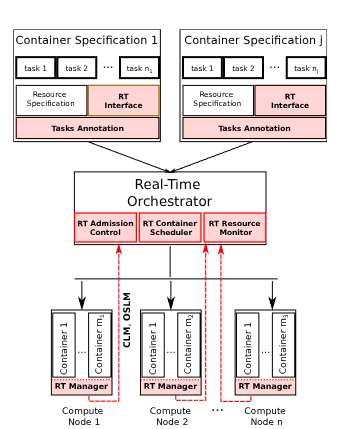

# REACT Enabling Real-Time Container Orchestration

## Problema

Fog e edge computing são atrativos para aplicações industriais com requisitos de tempo real, como o controlo de robôs, sobretudo combinados com contentores, que são leves e flexíveis. Há dois obstáculos. Os orquestradores existentes (Kubernetes, Docker Swarm, etc.) colocam contentores apenas com base em CPU, memória e disco, sem considerar requisitos temporais. Além disso, os contentores partilham o kernel e oferecem um isolamento fraco, pelo que cargas vizinhas podem degradar o desempenho temporal.

## Contribuições

1. **Arquitetura de orquestração** que permite a coexistência de contentores de tempo real (RT) e best-effort (BE), com isolamento temporal.
2. **Modelo matemático e métricas**. Cada contentor RT tem uma interface (P, Q): uma quota de CPU Q em cada período P, segundo o modelo de recurso periódico. São definidas duas famílias de métricas:
    - **OSLM** (ao nível do nó): utilização de CPU, interrupções/s, trocas de contexto, I/O.
    - **CLM** (ao nível do contentor): número de deadline misses, lateness máxima e tempo de resposta máximo das tarefas dentro do contentor.
3. **Implementação sobre Kubernetes**.

## Design

**No nó master**, a Admission Control faz duas verificações:
    - se há memória e armazenamento suficientes no nó;
    - um teste de utilização necessário: Σ Q/P + Q_new/P_new ≤ 1 − δ, onde δ é o overhead do sistema.
O teste é necessário mas não suficiente, devido a jitter, resolução de temporizadores, etc. O RT Container Scheduler escolhe entre os nós viáveis com base nas OSLM/CLM. Os autores enquadram este passo como um problema de otimização multiobjetivo, deixado para trabalho futuro. Um RT Resource Monitor guarda as métricas.
**Nos nós de computação**, um RT Manager faz o deploy dos contentores em modo RT, monitoriza as OSLM/CLM e reporta-as ao master.

## Implementação

- Assenta no patch de escalonamento hierárquico do Linux (Abeni et al.): SCHED_DEADLINE entre contentores e SCHED_FIFO/RR dentro de cada contentor.
- No Kubernetes, um RT Scheduler Extender acrescenta dois webhooks:
  - rt-filter: exclui nós que ficariam sobrecarregados;
  - rt-scoring: ordena os nós pela capacidade de CPU não reservada.
- O RT Manager corre como DaemonSet. As CLM são obtidas a partir de tracepoints injetados no kernel (contentor iniciado/throttled, início/fim de instância de tarefa).
- Para simplificar, assume-se no máximo um contentor RT por Pod.

## Avaliação

Feita num único nó: Intel i5, kernel 5.2 com o patch hierárquico, Docker 20.10.

- Contentores RT com 10% e 90% de utilização, com períodos de 1 ms a 1000 ms, competindo com contentores BE intensivos em CPU ou a correr stress-ng.
- Os contentores RT recebem praticamente a largura de banda reservada (por exemplo, 9,998% para 10%), com jitter muito baixo.
- O overhead mantém-se em cerca de 1–1,15%, independentemente do período e do número de contentores RT (1 a 7). Este overhead afeta apenas os contentores BE.
