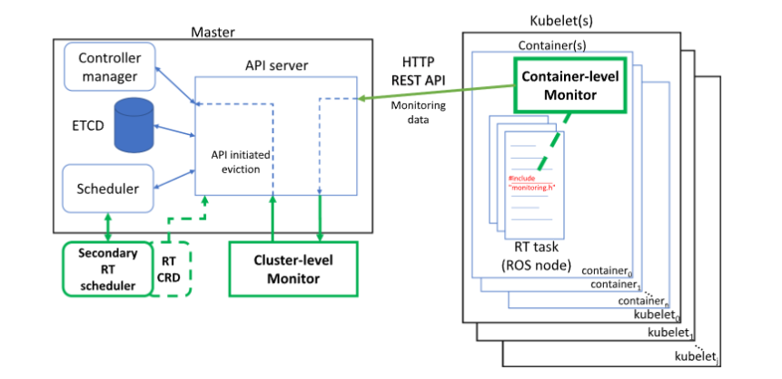

# Enabling Kubernetes Orchestration of Mixed-Criticality Software for Autonomous Mobile Robots

## Problema

O software de robôs autónomos mistura tarefas com exigências temporais muito diferentes, ou seja, são sistemas de criticidade mista (MCS). Por exemplo, o driver de um braço robótico tem requisitos de tempo real (RT) rígidos, o SLAM tem requisitos flexíveis, e outros nós ROS não têm restrições temporais. A containerização já é comum em robótica, mas o Kubernetes não tem qualquer noção de contentores RT. Trata todas as tarefas da mesma forma e pode colocar várias tarefas críticas no mesmo nó, sobrecarregando-o.

## A proposta: RT-Kube

O RT-Kube é uma extensão do Kubernetes (K3S) que não modifica o código-fonte do Kubernetes nem exige patches personalizados do kernel. Usa apenas Linux com PREEMPT_RT, pelo que funciona também em instalações geridas ou "provisionadas". Tem três componentes principais:

1. CRD para contentores RT. É um recurso personalizado onde se declaram:
   - criticidade (A, B ou C, inspirada nos níveis ASIL automóveis);
   - período e o prazo (deadline);
   - o WCET, que pode ser diferente em cada nó.
2. Escalonador RT secundário. Funciona em quatro fases:
   - Ordenação: ordena os contentores por criticidade.
   - Filtragem: aplica o teste de admissão EDF global do SCHED_DEADLINE. Um nó só é aceite se Σ WCET/P ≤ M × 0,95. Os contentores de criticidade C só vão para nós dedicados a C, regra imposta por um XOR.
   - Pontuação: a política depende da criticidade.
     - Tarefas A vão para o nó mais carregado, numa lógica de compactação.
     - Tarefas B usam uma função configurável que favorece nós com carga intermédia.
     - Tarefas C vão para o nó menos carregado.
   - Ligação do contentor ao nó escolhido. Os taints/tolerations excluem os nós sem SO de tempo real, e o hostNetwork evita o NAT para que os nós ROS comuniquem entre si.
3. Monitorização em dois níveis
    - Nível de contentor: captura o sinal SIGXCPU, emitido pelo kernel quando há um overrun, sem alterar o código da aplicação. Conta os prazos falhados e envia o estado ao servidor API em JSON, por HTTP, a 10 Hz.
    - Nível de cluster: executa a fase de reconcile. Quando os prazos falhados ultrapassam um limiar, expulsa um contentor stateless de criticidade inferior e marca o nó como temporariamente indisponível. Na prática, isto faz uma migração stateless para outro nó. Existem três políticas de seleção da vítima, com complexidade linear, n·log n e quadrática.

Os autores modelam ainda o tempo de resposta da recuperação como a soma de três parcelas: o período de atualização, a transmissão HTTP e a fase de reconcile.

## Resultados principais

- Overhead da containerização: é desprezável no tempo médio de execução. O WCET observado sobe cerca de 9,5%. Só há prazos falhados com utilização próxima de 100% (24 em 8 milhões), e esses desaparecem com uma ligeira folga no período.
- Benchmark sintético (73 tarefas): o Kubernetes padrão produz mapeamentos que o kernel rejeita no teste de admissão. O RT-Kube iguala a melhor configuração feita manualmente. Em cenários dinâmicos, o Kubernetes reinicia repetidamente contentores que falham, ou acerta no nó certo apenas em 50% dos casos. O RT-Kube deixa-os pendentes até haver recursos, ou escolhe sempre o nó correto.
- Caso real, robô Robotnik RB-Kairos (80 nós ROS):
  - O driver do braço corre a 120 Hz, com prazo de 8 ms, e entra em modo de segurança se o atraso passar de 0,7 ms.
  - Com o K3S nativo houve paragens de segurança. Com o RT-Kube multicriticidade não houve nenhuma, e os prazos falhados diminuíram uma ordem de grandeza.
- Tempo de recuperação:
  - Com as políticas linear e linearítmica, fica abaixo de 200 ms. Com a quadrática, ronda os 750 ms.
  - No robô, a média é de cerca de 90 ms e o pior caso de cerca de 408 ms. No pior caso, a rede representa metade desse tempo.
  - A tarefa migrada fica parada menos de 1 s em média (menos de 3 s no pior caso).

## Limitações a ter em conta

- A migração só funciona para tarefas stateless e implica um arranque a frio no novo nó. Para isso, as imagens têm de estar pré-carregadas em todos os nós.
- A criticidade máxima suportada é C. O nível ASIL-D exigiria hardware certificado.
- A latência da rede, sobretudo por WiFi, domina o pior caso. Os autores apontam as redes determinísticas como trabalho futuro.

## Resumo

### Inicialização

Os containers são ordenados por oderem de criticidade (A, B, C). O escalonador RT secundário filtra os nós que não têm SO de tempo real e aplica o teste de admissão EDF global. Depois, escolhe o nó com base na criticidade e liga o contentor a esse nó.

### Monitorização

O monitor de contentores captura o sinal SIGXCPU, conta os prazos falhados e envia o estado ao servidor API. O monitor de cluster executa a fase de reconcile. Quando os prazos falhados ultrapassam um limiar, expulsa um contentor stateless de criticidade inferior e marca o nó como temporariamente indisponível.

### Resultados

- Overhead da containerização: desprezável no tempo médio de execução. O WCET observado sobe cerca de 9,5%. Só há prazos falhados com utilização próxima de 100% (24 em 8 milhões), e esses desaparecem com uma ligeira folga no período.
- Benchmark sintético (73 tarefas): o Kubernetes padrão produz mapeamentos que o kernel rejeita no teste de admissão. O RT-Kube iguala a melhor configuração feita manualmente.
