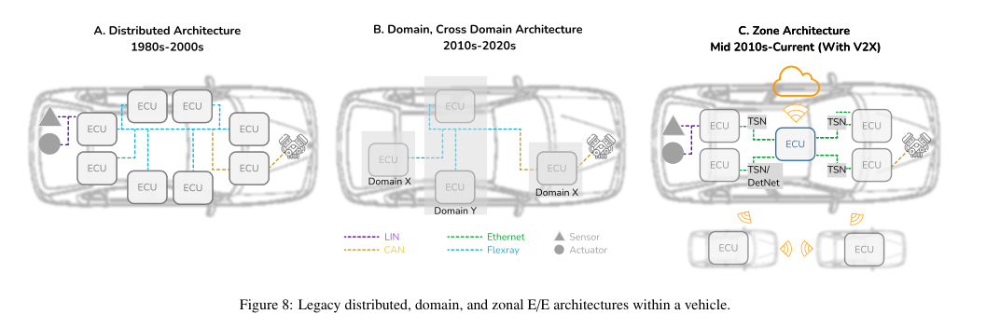
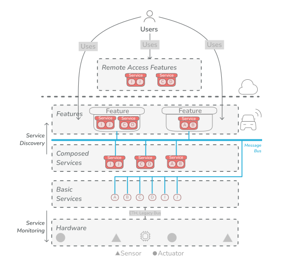
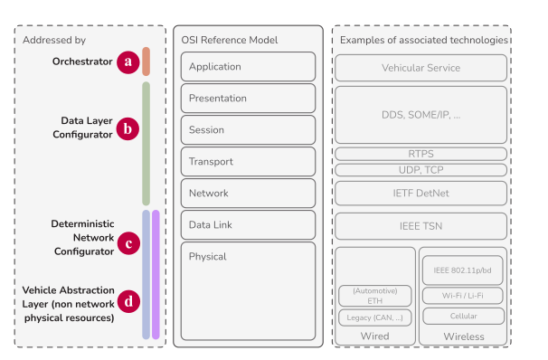

# Deterministic and Reliable Software-Defined Vehicles: key building blocks, challenges, and vision (IT)

## Building blocks

### Arquitetura E/E

A arquitetura E/E é a forma como a eletrónica e a computação do carro estão fisicamente organizadas: onde ficam as ECUs, o que cada uma faz e como se ligam entre si.

#### 1. Arquitetura distribuída

Cada nova funcionalidade trazia uma nova ECU, colocada perto dos sensores e atuadores que controlava e ligada por um barramento de comunicação. Esta abordagem tem sido usada durante décadas, mas está a tornar-se insustentável devido à complexidade crescente e ao aumento do número de ECUs.

Vantagens:

- Bom desacoplamento
- Sepração de Responsabilidades
- Resiliência a falhas

Desvantagens:

- Díficil de escalar
- Comunicação entre ECUs complexa
- Cablagem complexa e cara

#### 2. Centralização

Com a centralização, as ECUs são substituídas por unidades de computação mais poderosas (HPCs), que podem executar várias funções. A centralização permite reduzir o número de ECUs e simplificar a comunicação entre elas.

Níveis de centralização:

- **Dominio**: Os HPCs substituem as várias ECUs por domínio funcional (ex: powertrain, ADAS, infotainment). Cada domínio tem um HPC dedicado.
- **Cross-Domain**: Funções de vários domínios são executadas em HPCs ainda mais poderosos, permite reduzir a largura de banda e a complexidade da comunicação entre ECUs.
- **Zonal**: Agrupa-se as ECUs por zonas físicas do veículo (ex: frente, traseira, esquerda, direita). Cada zona tem um controlador que recolhe informações dos sensores e envia para a ECU Central mais poderosa.

### Arquitetura Orientada a Serviços

Maneira de organizar o software que corre nas ECUs.

Um serviço, pode ser algo de baixo nível que interage diretamente com os sensores e atuadores, ou algo de alto nível que combina serviços de baixo nível para fornecer uma funcionalidade mais complexa.

Como representado na imagem o hardware fica por baixo, os serviços de baixo nivel, os serviços de alto nível combinam serviços de baixo nível para fornecer funcionalidades mais complexas, e por cima temos a features que o utilizador usa. Tudo comunica por barramentos de mensagens.

Vantagens:

- desacouplamento entre hardware e software
- maior modularidade e separação de responsabilidades
- menos complexidade de hardware

Custo:

- Manter datrantias de disponibilidade e descobrimento

Troca de dados entre serviços:

- *Publish/Subscribe*: Um serviço publica dados e outros serviços subscrevem para receber esses dados.
- *pedido/Resposta*: Um serviço envia um pedido a outro serviço e espera por uma resposta.

Segundo o paper o Zenoh e o DDS são os melhores (PUB/SUB):

- *zenoh*: 2x débito do DDS e 50x MQTT
- *DDS*: melhor latencia, mais flexibilidade, mais niveis de Qos.

### Sistemas Operativos

Com o SOA, os serviços correm em ECUs e dependem do sistema operativo para serem executados na altura certa.
Por isso o requesito central é o escolonamento determinístico, que garante que os serviços são executados na altura certa. RTOS (Real-Time Operating Systems) são sistemas operativos que garantem que os serviços são executados por uma ordem e dentro de uma janela de tempo definidas.

opções de SO:

- Android Automotive
- Nvidia Drive OS
- Sistemas baseados em Yocto
- VxWorks
- QNX
- Eclipse ThreadX

A escolha do SO deve ser feita com base no tempo de execução no pior caso de cada tarefa, modularidade, tempo de resposta e jitter. Até ao momento da escrita do paper não foi feita qualquer comparação entre os SOs.

### Virtualização e Orquestração

Num SDV existem poucas ECUs que correm muitos serviços com criticidades diferentes. Isto exige isolar os serviços uns dos outros e gerir onde e como correm.

#### Virutalização

Virtualizar recursos permite correr vários sistemas operativos, tanto de tempo real como de uso geral, no mesmo hardware.

Vantagens:

- Isolamento entre serviços de diferentes criticidades
- Partilha de recursos de hardware
- Agregação de serviços em menos ECUs

Desafios:

- **Orquestração**: como distribuir os recursos pelas maquinas virtuais.
- **I/O partilhado**: como repartir dispositivos como portas USB e Ethernet entre as máquinas virtuais.
- **Tempo real**: o escalonamento ao nivel do hypervisor não é determinístico.

Implementações concretas:

- **Android Automotive** suporta virtualização com KVM e dispositos virtIO e comunica com o veiculo por gRPC.
- **Contentores** tem menos subrecarga e ocupam menos espaço do que a virtualização do hypervisor.
- **Eclipse Ankaios**: é um orquestrador feito para ECUs automóveis. Gere vários nós e VMs com uma unica API.

##### Kubernets

Foi pensado para Datacenters mas pode ser usado em SDVs. Há trabalho que propõe veículos como nós de um cluster Kubernetes. A sua flexibilidade de rede vem das CNIs (Container Network Interfaces), que configuram as interfaces de rede dos contentores e permitem integrar redes deterministas.

Um exemplo é o KuberneTSN, que usa um contentor sidecar para expor a interface de sockets POSIX aos outros contentores e redirecionar o tráfego para interfaces deterministas configuradas no anfitrião. A grande vantagem é não modificar os binários das aplicações, o que mantém a compatibilidade com serviços existentes e simplifica o desenvolvimento de novos.

### Comunicação entre veicular

Os serviços SOA e as VMs precisam de trocar dados entre ECUs, senosres e atuadores.

#### Ponto de partida: CAN

O CAN (Controller Area Network) foi desenvolvido pela Bosch para ligar os vários sistemas do carro. A grande vantagem é o custo baixo, porque só precisa de um par de cabos. Mas tem limitações que pesam cada vez mais:

- Precisa de mecanismos de deteção e mitigação de colisões.
- Escala mal e adapta-se mal a novo tráfego e novas mensagens.
- Pode haver starvation num barramento sobrecarregado de mensagens de alta prioridade.
- O débito é de 1 Mbit/s. O CAN-FD sobe o máximo prático para cerca de 6 Mbit/s e para 64 bytes de dados por trama, mas mantém os limites de número de nós e de comprimento do cabo.
- Como se baseia em broadcast, é frágil à injeção de mensagens falsas, uma falha de segurança.

#### Estratégia: Ethernet como backbone

LIN e CAN mantém-se nas extremidades do veículo, o objetivo final é que a longo prazo essas comunicações também sejas Ethernet. Entretanto a Ethernet é usada como backbone, ligada às HPCs com gateways para os barramentos legado.

Vantagens:

- payloads maiores e maior largura de banda
- suporte a váriso QoS e vários protocolos em camadas.
- baixa latencia e baixo jitter
- melhor latencia ponta a ponta que o FlexRay

### Comunicação interveicular

Não relevante para a Dissertação.

### Determinismo

O paper define determinismo como a entrega de pacotes de forma totalemtne resolvida, nos dominio temporal e de fiabilidade.

De onde vem o atraso: Num nó, um pacote passa por vários passos: filtragem, fila de espera,shaping, seleção de transmissão e da placa de rede. Cada passo introduz atraso que pode ser ilimitado e até aleatório.

#### DetNet (camada 3)

Controladores definem o comportamento dos nós.
Rotas explicitas para um encaminhamento determinista.
Alocação de recursos para proteger contra congestionamento.
Os pacotes são replicados por caminhos dijuntos para sobreviver a falhas de nós e links.

#### TSN (camada 2)

O TSN acresenta à Ethernet mecanismos de tempo, desempenho, fiabilidade e segurança. O 802.1Q define 3 classes de tráfego: Agendado (escalonamento preciso), reserva de fluxo (a configurar para garantir equidade) e Best Effort.

As funções principais são:

- **Sincronização de tempo**: precisão até ao nanosegundo, com o gPTP/PTP (802.1AS, 1588). Tem de contar com as latências da camada física, e o 802.3cx propõe reportá-las dinamicamente.
- **Replicação e eliminação para fiabilidade (FRER, 802.1CB)**: tramas replicadas por caminhos disjuntos, com eliminação das duplicadas.
- **Gestão de recursos (802.1Qcc)**: configuração de talker, listener e equipamento intermédio.
- **Latência e largura de banda limitadas**: Feitas pelos shapers.

Os 3 shapers:

- **CBS (Credit Based Shaper)**: um contador de crédito decide se a trama pode ser enviada. O crédito acumula quando a fila está inativa e gasta-se ao transmitir, com taxas configuráveis (idle slope e send slope). Suaviza o tráfego e reduz picos.
- **TAS (Time Aware Shaper)**: associa o tráfego a classes e as classes a portas (gates) que abrem e fecham a horas e durante intervalos fixos. Assim as classes que não devem competir nunca competem, o que elimina o jitter causado por essa competição. É o mais citado ao longo do paper.
- **ATS (Asynchronous Traffic Shaping)**: baseia-se no princípio do leaky bucket e permite a transmissão quando o crédito excede o tamanho da trama.

Como se configura a rede:

- **Totalmente distribuído**: as estações comunicam os requisitos entre si (SRP ou RAP).
- **Rede centralizada, utilizador distribuído**: uma entidade, o CNC, reúne as capacidades da rede.
- **Totalmente centralizado**: o CNC é ajudado pelo CUC.

Desafios:

- **Cenário Critico**: o automóvel exige latências bem definidas, ordenação e fiabilidade muito alta.
- **Dinamismo**: a topologia intra e interveicular muda muito. Cada veículo pode ter um conjunto diferente de sensores e atuadores, pelo que a configuração do TSN tem de ser mais automatizada e adaptável a diferentes fluxos.

Ethernet com CAN:

- **Snapshot periodico**: Periodicamente, todas as tramas originais sõa mapiadas para uma ou mais tramas do barramento destino. Dificil de calcular o periodo do snapshot.
- **Empacotamento 1:1**: Uma trama do barramento de origem vai para uma ou mais tramas do barramento destino. Desperdiça espaço.
- **Empacotamento total**: Todas as tramas do barramento de origem até um certo ponto são mapeadas para uma trama do barramento destino. Aporveita melhor o MTU do que o 1:1.

### Arquitetura proposta

Um serviço pode correr numa ou mais ECUs, ou dividio por um cluster de veiculos. Em qualquer caso a informação não pode chegar cedo nem tarde, por isso tem de ser determinista.
Os autores defendem uma gestão dinamica por camadas.

Componentes:

- **Controller**: Ponto de entrada. Recebe o descritor de serviço e decide recursos e localização, e coordena os quatro componentes seguintes
- **Configurador de rede determinista**: Cria os fluxos de tráfego e configura as NICs das ECUs e os switches TSN
- **Configurador da camada de dados**: Escolhe e configura o protocolo SOA adequado
- **Orquestrador**: Implanta os serviços em nós Kubernetes, VMs (KVM) ou contentores (containerd)
- **Vehicle Abstraction Layer (VAL)**: Abstrai ECUs, sensores e atuadores, reais ou simulados, sobre frameworks como AUTOSAR ou Autoware

#### Controller

Com base em métricas definidas pelo utilizador e pelo sistema no descritor, decide a quantidade e a colocação dos recursos ao longo do computing continuum e dos veículos da cidade. Tem em conta handovers e o uso ótimo dos recursos de computação e de rede. O algoritmo recebe o descritor e as características dos nós, e dá a cada nó uma pontuação e um sim/não (para requisitos obrigatórios). Depois despacha a configuração para os N melhores nós. A escolha pode ser automática, manual ou por critérios (tempo, energia, custo), e o Controller tem de garantir limites de latência tanto na implantação como na troca de mensagens.

#### Rede determinista

 Assegura que as mensagens, de controlo ou de estado, chegam dentro de um limite de tempo e com fiabilidade. Os temas de investigação incluem sincronização de relógios em redes veiculares sem fios e a definição automática e otimizada de fluxos, prioridades de fila e características. Esperam-se pelo menos três classes de tráfego: mensagens de controlo com máxima criticidade, fluxos grandes (periódicos ou não) e mensagens de serviço (periódicas ou não).

#### Camada de dados

O tema de investigação é uma camada de abstração que aumente a interoperabilidade entre protocolos e mantenha o determinismo através da integração com a rede por baixo.

#### Orquestrador

Também aqui o desafio é garantir comunicação determinista, através da integração com os mecanismos de rede.

#### VAL

Recebe as ordens dos três componentes anteriores em cada ECU. A analogia é com as abstrações de hardware que os sistemas operativos criaram nos anos 80 e 90. O paper cita um trabalho que a estende ao veículo (Figura 22), com zonas de confiança e sem confiança, e separação entre funções de segurança e outras. A VAL pode ainda incluir a criação de um gémeo digital do veículo para estudar o impacto de sensores e serviços nas redes.

#### Interação ponta a ponta (secção 6.1, Figura 23)

O programador interage de forma declarativa: define o estado pretendido, como no Kubernetes, através de um descritor de serviço. Cada campo devia ter não só o valor mas também a sua criticidade, porque um nó pode não cumprir tudo e o Controller precisa de saber que métricas podem falhar e por que margem.

O exemplo (Listagem 1) é um serviço WheelchairDriver, ligado ao caso de uso da cadeira de rodas:

- **Metadados**: autor, versão e domínio safety.
- **NodeSpecs**: imagem docker, 2 réplicas, 2 CPUs, 1024 de memória, sem GPU, sem offloading.
- **DataSpecs**: formato JSON, tamanho 8096.
- **TrafficSpecs**: fiabilidade e entrega garantidas, meio com fios, latência máxima 50, periodicidade 100, jitter 10 e offset de transmissão 0.

Para este serviço o Controller de cada veículo teria de:

1. implantar os contentores necessários;
2. alocar e configurar recursos numa ECU ligada aos atuadores (os motores dos pontos de fixação e da rampa);
3.configurar os switches e restante equipamento de rede com mecanismos deterministas (por exemplo, TAS do TSN);

tudo isto sem prejudicar os serviços que já estão a correr.
