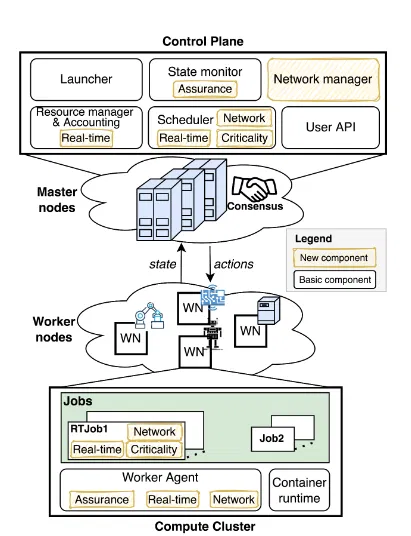

# Introducing k4.0s: a Model for Mixed-Criticality Container Orchestration in Industry 4.0

## Problema

Na Indústria 4.0, os nós de edge/fog executam lado a lado tarefas muito diferentes: controlo em tempo real, machine learning, aquisição de dados. São, por isso, sistemas de criticidade mista. Os orquestradores atuais, como o Kubernetes, já começam a suportar contentores de tempo real, mas têm quatro lacunas:

Tratam os nós como equivalentes. Só distinguem CPU e memória, ignorando as garantias que cada nó oferece (kernel de tempo real, aceleradores, proximidade aos sensores).
A monitorização foi pensada para cargas best-effort.
Conhecem pouco a rede. Não distinguem TSN, CAN bus, redes sem fios, etc.
O plano de controlo não é de tempo real. Não dá garantias de latência nas decisões.

## Modelo

- **Nós de trabalho**: cada nó tem um nível de garantia (assurance) Aᵢ = αᵢ + βᵢ + γᵢ(t), ou seja, a soma das contribuições do hardware, do software e do estado dinâmico do sistema. O termo γᵢ(t) permite baixar temporariamente a garantia de um nó quando uma carga vizinha ameaça uma tarefa crítica. Cada nó indica também se tem capacidade de tempo real.
- **Recursos**: há recursos básicos (CPU, disco, memória) e recursos adicionais (sensores, atuadores, GPU, FPGA), estes alocados em exclusivo.
- **Redes**: cada rede é modelada como um grafo com matriz de atrasos, e cada tipo de rede é tratado de forma distinta. Uma rede TDMA, por exemplo, exige análise de escalonabilidade.
- **Jobs**: cada job tem um nível de criticidade (NO, LOW ou HI), requisitos de tempo real e requisitos de rede. As réplicas podem ter criticidades diferentes (líder e backups, ou TMR). Jobs de alta criticidade devem correr em nós de alta garantia, com isolamento forte (por exemplo, contentores baseados em hipervisor).
- **Tarefas**: em vez do par simples (período, orçamento), cada tarefa tem um período, uma prioridade opcional e um WCET que depende da criticidade e do nó, inspirado no modelo de Vestal. Assim, o master não precisa de conhecer o algoritmo de escalonamento usado em cada nó.

## Arquitetura e implementação

O sistema divide-se em duas partes que comunicam em ciclo:

O plano de controlo (topo) corre nos master nodes, normalmente vários, que se mantêm sincronizados por consenso (o ícone do aperto de mão) para não haver um ponto único de falha. É aqui que se tomam as decisões globais.
O compute cluster (baixo) é composto pelos worker nodes (WN), que executam efetivamente o trabalho. Na figura são heterogéneos: um tem braços robóticos (atuadores), outro um robô, outro um servidor. Isto ilustra o cenário da Indústria 4.0.

### Plano de Controlo

-**Launcher**: envia aos nós as ações decididas. Não muda.
-**State monitor**: guarda o estado global e reage quando este se desvia do desejado. Ganha a extensão Assurance: passa a acompanhar o nível de garantia Aᵢ de cada nó e a sua capacidade de tempo real.
-**Resource manager & Accounting**: contabiliza os recursos disponíveis. Ganha a extensão Real-time, passando a contabilizar também recursos de tempo real, como a largura de banda de CPU reservada.
-**Scheduler**: decide onde colocar cada job. É o componente mais estendido, com três etiquetas:
    -**Criticality**: usa políticas de colocação diferentes conforme a criticidade. Jobs críticos vão para nós de alta garantia; jobs não críticos privilegiam a consolidação, para poupar recursos e energia. Jobs críticos podem ainda preemptar jobs menos críticos se faltarem recursos.
    -**Real-time**: deteta a interface de tempo real do job (períodos e WCETs das tarefas) e delega o teste de escalonabilidade aos nós. O escalonador não precisa de saber que algoritmo cada nó usa.
    -**Network**: delega ao Network manager a verificação dos requisitos de rede.
-**User API**: recebe e valida os pedidos de deployment. Não muda.
-**Network manager**: conhece a topologia física e os vários tipos de rede (TSN, CAN, TDMA, best-effort). Gere, por exemplo, os timeslots TDMA ocupados, as matrizes de atraso ou a capacidade de cada ligação. Inclui também serviços para aplicações críticas: um replica manager, que encaminha pedidos para a réplica líder ou para os backups, e um TMR voter, que compara as respostas de três réplicas e decide por maioria.

### Compute Cluster

- **Worker Agent**: recolhe informação de saúde e mantém o estado desejado. O equivalente no Kubernetes é o kubelet. Ganha três módulos:
  - **Assurance**: monitoriza métricas do sistema (intr/s, sys%, loadavg…) e reage em três fases: deteta anomalias, tenta matar a carga menos crítica responsável e, se o problema persistir, baixa o γᵢ(t) do nó e pede a migração do job crítico.
  - **Real-time**: recebe pedidos de tempo real, corre o teste de escalonabilidade localmente e reserva os recursos.
  - **Network**: passa a suportar redes como TSN e TDMA e a atribuir recursos de rede aos jobs.
- **Container runtime (ex.: Docker)**: não muda.
- **Jobs**: o conceito de job é estendido. Na figura, o RTJob1 traz as etiquetas Real-time, Criticality e Network, ou seja, o pedido inclui o nível de criticidade, a interface de escalonamento de cada tarefa e os requisitos de rede (por exemplo, a duração e o período do timeslot TDMA). O Job2 é um job normal, sem essas extensões, o que mostra que os dois tipos convivem no mesmo nó.

### Como tudo funciona em conjunto

1. O utilizador submete o job pela User API, com criticidade HI, períodos e WCETs, e um requisito de timeslot TDMA.
2. O Scheduler filtra os nós sem garantia suficiente, com base na informação do State monitor.
3. Pede a cada nó candidato que corra o teste de escalonabilidade, através do módulo Real-time do Worker Agent.
4. Pede ao Network manager um timeslot livre.
5. Escolhe o nó e o Launcher envia a ação.
6. Durante a execução, o módulo Assurance vigia o nó. Se uma carga vizinha começar a perturbar o job crítico, tenta eliminá-la. Se não conseguir, baixa a garantia do nó e o plano de controlo migra o job.

## k4.0s vs Kubernetes normal

| Aspeto | Kubernetes normal | k4.0s |
|---|---|---|
| **Visão dos nós** | Os nós distinguem-se sobretudo pelos recursos (CPU, memória) e por labels ou taints definidos manualmente | Cada nó tem um **nível de garantia** Aᵢ = αᵢ + βᵢ + γᵢ(t) (hardware, software e estado atual) e uma capacidade de tempo real explícita |
| **Garantia dinâmica** | Não existe. Um nó está "pronto" ou "não pronto" | O termo γᵢ(t) faz a garantia **baixar em tempo real** se o nó ficar perigoso para cargas críticas |
| **Criticidade das cargas** | Há PriorityClasses (preempção) e classes de QoS (Guaranteed, Burstable, BestEffort), mas estas refletem prioridade e reserva de recursos, não garantias de isolamento | Criticidade explícita **NO / LOW / HI**, ligada ao nível de garantia exigido ao nó e ao tipo de virtualização (por exemplo, hipervisor para HI) |
| **Pedido de CPU** | `requests` e `limits` em milicores, uma noção de quantidade média de CPU | Cada tarefa tem **período, WCET e prioridade**, e o WCET depende da criticidade e do nó |
| **Tempo real** | Sem noção de deadlines nem testes de escalonabilidade. No máximo, há CPUs dedicados (CPU Manager) | O scheduler pede a cada nó um **teste de escalonabilidade** (plugável) e reserva largura de banda de tempo real |
| **Estratégia de colocação** | Pontuação genérica, igual para todos os pods (salvo configuração manual) | **Políticas por criticidade**: os jobs críticos preferem os nós de maior garantia, os não críticos privilegiam a consolidação |
| **Rede** | Normalmente uma única rede plana (CNI). Redes múltiplas só com extensões como o Multus, e sem raciocínio de tempo real | Várias redes modeladas explicitamente (TSN, CAN, TDMA, best-effort), com matrizes de atraso, timeslots e **testes de escalonabilidade de rede** |
| **Recursos heterogéneos** | GPUs e FPGAs através de device plugins | GPUs, FPGAs, **sensores e atuadores** entram no modelo como recursos alocáveis |
| **Monitorização** | Métricas pensadas para cargas best-effort (CPU e memória médias, saúde do nó) | Métricas escolhidas pela **correlação com a latência e o slack** de tarefas de tempo real, e específicas de cada kernel |
| **Reação a interferências** | Despejo (eviction) apenas por falta de recursos, como pressão de memória ou disco | Reação em três fases: deteta a anomalia, mata o job menos crítico responsável e, se não chegar, baixa a garantia do nó e **migra o job crítico** |
| **Redundância** | ReplicaSets com réplicas idênticas e load balancing simétrico | Réplicas com **criticidades diferentes** (líder e backups), um replica manager e um **votador TMR** |

**Limite comum:** em ambos, o plano de controlo não é de tempo real — as decisões de escalonamento e migração não têm latência garantida (trabalho futuro no k4.0s).