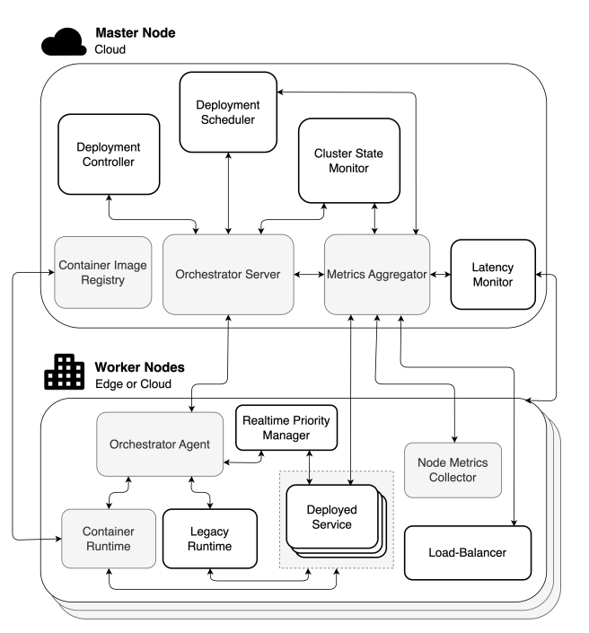

# Guião

Em vez de explicar cada paper por completo, resumo a proposta de cada um e o que lhe falta. A ordem é: orquestração com base no CPU, orquestração com CPU e rede, orquestração em SDVs e, no fim, TSN em redes overlay.

---

## Bloco de papers

### Orquestração com base no CPU

O objetivo destes papers é pôr o maior número possível de tarefas RT a correr sem que interfiram umas com as outras.

#### REACT

- Cada container RT declara (Q, P): Q é o tempo de CPU de que precisa e P o período em que é executado.
- Um nó só aceita o container se a soma de Q/P de todos os containers RT, incluindo o novo, for ≤ 1 − δ, em que δ é uma margem para o overhead do nó. Dos nós que passam o teste, escolhe o que tem mais CPU por reservar.
- No nó, o container recebe Q de CPU em cada período P. Se Q estiver mal calculado e o container o esgotar sem acabar, fica suspenso até ao período seguinte.
- Monitoriza o nó (interrupções, trocas de contexto, I/O) e o container (deadlines falhados, lateness, tempo de resposta).

**Lacuna:** Não leva em consideração vários níveis de criticidade, nem a rede.

#### RT-Kube

- Um CRD com criticidade, período, deadline e WCET (Worst Case Execution Time).
- Um scheduler secundário ordena os containers por criticidade, faz o teste de admissão Σ WCET/P ≤ M × 0,95 (M = número de cores) e coloca-os nos nós segundo a criticidade.
- Em runtime conta os deadlines falhados. Acima de um limiar, expulsa um container stateless de criticidade inferior, que é reagendado noutro nó.
- É um robô móvel com ROS, por isso é o caso mais próximo do Autoware.

**Lacuna comum:** nenhum dos dois tem a rede em consideração.

---

### Orquestração consciente da rede

São os mais semelhantes ao meu trabalho: propõem arquiteturas que juntam a plataforma de containers e a rede, em contexto industrial.

#### FabOS

1. O SCC recebe o pedido da aplicação e pede ao SCO um plano de colocação dos workloads.
2. O SCNS pede ao MoNC (o CNC) os streams TSN que esse plano exige.
3. O MoNC verifica se consegue garantir as latências. Se sim, configura as bridges; se não, devolve um erro e o SCC pede um novo plano.
4. Com os streams garantidos, o SCS arranca os pods. O tráfego TSN sai por um plugin CNI que adiciona o VLAN ID e o PCP.

**Lacunas:** não tem monitorização em runtime; o shaping é prioridade + PSFP (não TAS); não trata o RT do CPU; não tem criticidade.

#### k4.0s

Plano de controlo corre nos nós com maior computação (equivalente aos HPCs) e o compute cluster corre nos worker nodes ( equivalente às ECUs) (Não meter esta frase na apresentação)

1. O utilizador submete o job pela User API, com criticidade HI, períodos e WCETs, e um requisito de timeslot TDMA.
2. O Scheduler filtra os nós sem garantia suficiente, com base na informação do State monitor.
3. Pede a cada nó candidato que corra o teste de escalonabilidade, através do módulo Real-time do Worker Agent.
4. Pede ao Network manager um timeslot livre.
5. Escolhe o nó e o Launcher envia a ação.
6. Durante a execução, o módulo Assurance vigia o nó. Se uma carga vizinha começar a perturbar o job crítico, tenta eliminá-la. Se não conseguir, baixa a garantia do nó e o plano de controlo migra o job.

**Lacunas:** a rede é TDMA, não TSN; a avaliação motiva o modelo mas não testa a colocação.

#### Edge-Cloud Continuum Orchestration

- Estende o Kubernetes para serviços críticos numa smart city. Usa um CRD próprio (FogService) com os parâmetros RT de cada serviço.
- Plugin RT no scheduler: o Filter rejeita nós onde o pod ultrapassaria a quota RT (95%), o Score espalha os pods RT pelos nós, e o PostFilter expulsa pods de prioridade mais baixa se não houver espaço.
- Plugin de dependências: coloca o pod perto das réplicas de que depende, usando a latência medida (ping) entre nós e métricas da aplicação.
- Em runtime, simula de novo o scheduling de cada pod e, se houver um nó melhor, expulsa-o para ser recolocado.

**Lacunas:** apesar de considerar a latência da rede, não usa TSN.

---

### Orquestração em SDVs

Foi o único paper relevante que encontrei sobre escalonamento num veículo SDV.

- Propõe um algoritmo que decide em conjunto onde processar cada tarefa e por que caminho, numa arquitetura zonal (4 ECUs zonais + 1 unidade central).
- O objetivo não é a menor latência mas sim a maior taxa de tarefas cumpridas dentro do prazo, o que é mais importante para funções críticas. Também prefere caminhos mais fiáveis.

**Lacunas:** assume que conhece as tarefas à partida (diz que é dinâmico, mas não explica como); é só simulação; não usa TSN.

**O que aproveito:** as baselines deles. A "estática" (cada tarefa na ECU da sua zona) é o que o operador faz hoje.

---

## Gap

| | Orquestrador decide a colocação | Rede TSN configurada | RT do CPU | Contexto veículo | Monitorização em runtime |
|---|---|---|---|---|---|
| REACT | ✓ | ✗ | ✓ | ✗ | ✓ |
| RT-Kube | ✓ | ✗ | ✓ | ✗ | ✓ |
| Edge-Cloud | ✓ | ✗ | ✓ | ✗ | ✓ |
| FabOS | ✓ | ✓ | ✗ | ✗ | ✗ |
| k4.0s | ✓ | ✗ | ✓ | ✗ | ◐ |
| SDV | ✓ | ✗ | ✗ | ✓ | ✗ |

---

## Extra

### Bridging Time-Sensitive Networking and Containerization

- TSN em containers Docker: as apps BE ficam numa bridge e as apps TSN usam a rede do host, para conseguirem configurar a NIC (TAS/CBS).
- Com TAS + LaunchTime os resultados ficam quase iguais ao nativo; com CBS basta o shaper.
- Identificam dois problemas: várias apps a configurar o mesmo TAS entram em conflito, e mais containers num nó estragam configurações que eram ótimas.

Lacuna: usa a rede do host, que não é o padrão da indústria (overlay) e expõe o host.

### KuberneTSN

- Plugin CNI que dá TSN a pods numa rede overlay.
- Interceta os pacotes TSN antes de saírem do container. Um container próprio faz o shaping (TAS) e envia-os com kernel bypass (DPDK).
- Latência e jitter praticamente iguais a bare-metal.

**Vantagem:** latência e jitter ao nível do bare-metal.

**Desvantagens:** com o kernel bypass perdem-se a monitorização e a segurança do kernel. Presumo também que, pela forma como o DPDK funciona, fique um core ocupado a fazer polling (o paper não o diz).

### TSN Metadata Proxy

- Plugin CNI que preserva os metadados TSN nos pacotes.
- Um programa eBPF guarda a prioridade e o txtime à saída do pod e volta a pô-los antes da NIC.

**Vantagem:** os pacotes continuam a passar pelo kernel, e o custo deve ser baixo (12 bytes por pacote).
**Desvantagens:** não reduz a latência do container e não fizeram testes de desempenho. Deixam explicitamente de fora a configuração centralizada da rede.

---

## Proposta
