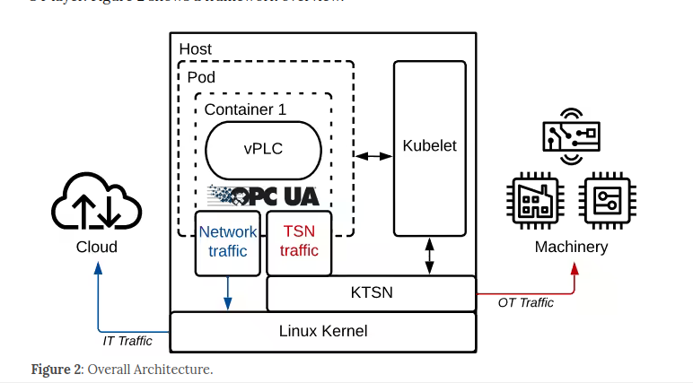

# Suporting vPLC Networking over TSN with Kubernetes in Industry 4.0

## Problema

Na Indústria 4.0 procura-se substituir os PLCs tradicionais, que usam hardware dedicado e caro e formam ecossistemas fechados, por PLCs virtuais (vPLCs) em software, a correr em contentores sobre hardware comum (COTS). O obstáculo está nos requisitos da tecnologia operacional (OT): latência baixa, jitter mínimo e determinismo. As soluções anteriores não cumpriam estes requisitos ou só os cumpriam à custa da flexibilidade de TI, por exemplo com RTOS, hipervisores proprietários (que trazem vendor lock-in) ou passthrough de rede (que impede a migração em tempo real).

## Proposta

Os autores apresentam um framework aberto cuja ideia central é separar claramente os caminhos de dados para os dois tipos de tráfego:

- O vPLC corre num contentor dentro de um pod Kubernetes, o que traz escalabilidade, alta disponibilidade e gestão automatizada.
- O OPC-UA é o middleware único para todas as comunicações.
- O tráfego de TI (para a cloud ou edge) segue o caminho normal, best-effort, do kernel Linux.
- O tráfego de OT (para as máquinas) usa o perfil TSN do OPC-UA e é interceptado pelo KuberneTSN (KTSN), um plugin dos próprios autores. O KTSN funciona como escalonador TSN em userspace com kernel bypass (DPDK) e envia os pacotes diretamente para a rede no instante de transmissão definido. Os autores estenderam-no para suportar pacotes Ethernet brutos no formato UADP, usado pelo OPC-UA Pub/Sub.

## Avaliação

O testbed real tem dois nós (Intel i9, NIC Intel I225 com suporte TSN, Ubuntu 22.04) ligados por um switch TSN e sincronizados por PTP. Um vPLC publica mensagens OPC-UA com ciclo de 25 µs, e compara-se a versão em contentor com a versão bare-metal para payloads de 64, 256 e 1024 B.

**Latência**: a mediana vai de 29,7 µs (64 B) a 50,1 µs (1024 B). A diferença para o bare-metal é constante, cerca de 7,6 µs, e deve-se ao escalonador KTSN, ao switch virtual e ao encapsulamento VXLAN.
**Jitter**: a mediana é aproximadamente 0 e a variabilidade é menor do que em bare-metal, porque o escalonador em userspace é mais estável que o do kernel. O jitter fica abaixo de 1 µs em mais de 90% dos casos.

## Resumo

A meu ver este paper não acresenta nada de novo que não esteja no KuberneTSN, exceto a possibilidade de enviar o tráfego best-effort pela rede normal do kubernets e mandar apenas o tráfego TSN pelo KTSN.
Oferece uma maior latencia mas o jitter é constante.
