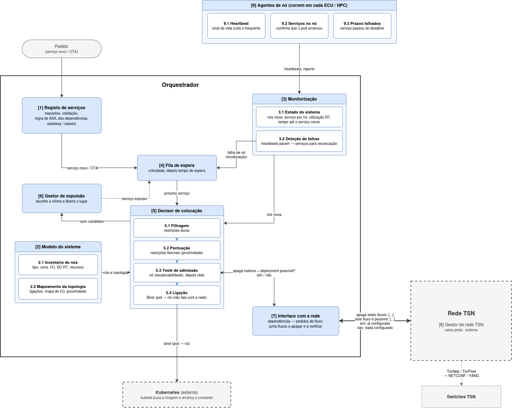

# Proposta

## CRD - Requisitos de Serviço RT

### Requisitos de Criticidade

- Nível de criticidade do serviço, com os níveis ASIL da ISO 26262 (QM, A, B, C, D)

| ASIL | Descrição |
|---|---|
| D | Criticidade Máxima |
| C | Criticidade Média-Alta |
| B | Criticidade Média-Baixa |
| A | Criticidade Baixa |
| QM | Quality Management |

Uso:

- Serviços são colocados por ordem de criticidade.
- Quando não há recursos para colocar um serviço, um serviço menos crítico pode ser expulso.

#### Expulsão

- Só podem ser expulsos serviços **stateless** e **menos críticos** do que o serviço a colocar.
- O serviço expulso é **recolocado noutro nó**, se houver espaço. Se não houver, fica à espera de recursos.

Filtro de escolha:

1. Os de menor criticidade.
2. Destes, só os stateless.
3. Destes, preferir os que não têm ninguém dependente deles.
4. Critério de desempate (em aberto).

**Regra:** um serviço só pode depender de serviços com ASIL igual ou maior. Assim, uma expulsão nunca deixa sem dados um serviço mais crítico.

### Requesitos Temporais

- Periodo: De quanto em quanto tempo o serviço executa
- WCET: Tempo máximo de execução do serviço (Depende do nó).
- Deadline: Tempo máximo entre o serviço ser ativado e terminar.
- Tempo máximo de indisponibilidade: quanto tempo o serviço pode estar parado quando é recolocado.

### Dependencias

O serviço declara no CRD do que precisa.

```text
D - Restrição Dura
F - Restrição Flexível
```

#### Dependencias de serviço

- Interface de I/O (D)
- Proximidade a sensores/atuadores (F)
- Proximidade a outros serviços (F)

#### Dependências de comunicação

- Serviço de que depende (D)
- Tamanho da mensagem / payload (D)
- Período da comunicação (D): pode ser diferente do período de execução do serviço
- Latência máxima (D)

#### Dependências de Recursos

- Memória (D)
- Armazenamento (D)

#### Dependencias de Plataforma

- SO de tempo real (D)
- Aceleradores (D)

### Exemplo do CRD

```yaml
# Exemplo do CRD de serviço.
---
apiVersion: sdv.dev/v1
kind: RtService
metadata:
  name: object-detection
spec:
  asil: C                       # QM | A | B | C | D
  stateless: true               # só os stateless podem ser expulsos

  timing:
    period: 100ms
    deadline: 60ms              # pode ser menor que o período
    maxDowntime: 500ms          # tempo máximo parado ao ser recolocado
    wcet:                       # um valor por tipo de nó;
      hpc: 25ms                 # sem "zonal" = não pode correr numa ECU, apenas em HPC

  placement:
    io:
      required: []              # interfaces obrigatórias (D), ex.: [can0]
      preferred: [lidar-front]  # proximidade a sensores/atuadores (F)
    nearServices: [sensor-fusion]   # proximidade a outros serviços (F)
    platform:
      rtOS: true                # precisa de SO de tempo real (D)
      accelerators: [gpu]       # precisa de GPU (D)

  dependsOn:                    # quem ENVIA dados para este serviço
    - service: lidar-preprocess
      payload: 1500B
      period: 100ms             # pode ser diferente do período do serviço
      maxLatency: 2ms
    - service: radar-front
      payload: 256B
      period: 50ms
      maxLatency: 1ms

  # Pod normal do Kubernetes. Memória e armazenamento.
  template:
    spec:
      containers:
        - name: detector
          image: registry.local/autoware/object-detection:1.0
          resources:
            requests:
              memory: 2Gi
              ephemeral-storage: 1Gi
---
apiVersion: sdv.dev/v1
kind: RtService
metadata:
  name: brake-control
spec:
  asil: D
  stateless: false              # tem estado: nunca é expulso

  timing:
    period: 10ms
    deadline: 5ms
    maxDowntime: 50ms
    wcet:
      zonal: 2ms                # pode correr na ECU...
      hpc: 0.5ms                # ...e no HPC

  placement:
    io:
      required: [can0]          # só nos nós com interface CAN
      preferred: []
    nearServices: []
    platform:
      rtOS: true
      accelerators: []

  dependsOn:
    - service: planner
      payload: 128B
      period: 10ms
      maxLatency: 1ms           # o planner tem de ser ASIL D (regra das dependências)

  template:
    spec:
      containers:
        - name: brake
          image: registry.local/autoware/brake-control:1.0
          resources:
            requests:
              memory: 256Mi
```

## Arquitetura do scheduler



### Entidades

#### 1. Registo de serviços

- Recebe e guarda os requisitos que cada serviço declara (temporais, criticidade, dependências, recursos, plataforma).
- Valida-os (ex.: deadline ≤ período, há pelo menos um tipo de nó com WCET).
- Valida a regra de criticidade: um serviço só pode depender de serviços com ASIL igual ou maior (o ASIL é declarado pelo próprio serviço).
- Sabe se o serviço é stateless ou stateful.

#### 2. Modelo do sistema

Uma entidade com duas funções separadas. Tudo o que tem é conhecido à priori e não muda durante a condução.

##### 2.1 Inventário de nós

- Sabe o que cada nó **tem**: tipo (ECU zonal / HPC), zona, interfaces (ex.: CAN), SO RT, aceleradores, memória, armazenamento, CPU RT.

##### 2.2 Mapeamento da topologia

- Sabe como a rede está ligada: switches, ligações, que nó está ligado a que switch e em que zona (reutilizar o `NetworkTopology` do Rodrigo).
- Sabe onde estão os sensores/atuadores (mapa de I/O).
- Responde a perguntas de **proximidade**: quantos saltos entre dois nós, ou entre um nó e um sensor. É o que alimenta as restrições flexíveis.

#### 3. Monitorização

Uma entidade com duas funções separadas.

##### 3.1 Estado do sistema

- Mantém o estado **vivo**: que nós estão vivos, que serviço corre em cada nó, utilização RT atual de cada nó (Σ C/P).
- É a fonte do estado que o decisor usa no teste de admissão.

##### 3.2 Deteção de falhas

- Deteta a falha de serviços ou de um nó e põe os serviços na fila de espera, marcados como recolocação (com o tempo máximo de indisponibilidade a contar).

#### 4. Fila de espera

- Recebe pedidos de colocação: serviços novos, atualizações OTA, recolocações após falha, serviços expulsos.
- Ordena por criticidade e, dentro do mesmo nível, por tempo de espera.
- Entrega os serviços um a um ao decisor.

#### 5. Decisor de colocação (scheduler)

Uma entidade com quatro funções separadas, aplicadas por esta ordem ao serviço à cabeça da fila.

##### 5.1 Filtragem (restrições duras)

- Elimina os nós que não servem: sem WCET para o tipo de nó, sem SO RT, sem o acelerador, sem a interface de I/O, sem memória ou armazenamento.

##### 5.2 Pontuação (restrições flexíveis)

- Ordena os nós que sobram pela proximidade a sensores/atuadores e a outros serviços, usando o mapeamento da topologia.

##### 5.3 Teste de admissão

- Para cada candidato, pela ordem da pontuação, responde a "este serviço cabe neste nó **sem pôr em risco os prazos dos que já lá estão**?".
- Lado do nó: utilização RT / análise de escalonabilidade com os WCET desse tipo de nó.
- Lado da rede (só se o lado do nó passar): manda à rede, pela interface com a rede, **um só pedido**:
  - *apaga estes fluxos: [...]*: os fluxos inativos (de serviços expulsos, movidos ou de nós que falharam);
  - *este fluxo é possível: [...]*: os fluxos das dependências do serviço, para este nó.
- A rede verifica e, se for possível, **configura logo os switches** e só depois responde sim. Se responder não, nada fica configurado.

Se nenhum candidato passa: chama o gestor de expulsão (se for uma recolocação que vai perder o tempo máximo de indisponibilidade) ou deixa o serviço à espera na fila.

##### 5.4 Ligação

- Corresponde à fase Bind do scheduler do Kubernetes: diz ao Kubernetes "este pod vai para este nó". A partir daí é o Kubernetes que faz o deployment real.

#### 6. Gestor de expulsão

- Escolhe a vítima pelo critério descrito anteriormente: menos crítico, stateless, de preferência sem dependentes.
- Liberta o lugar e devolve o serviço expulso à fila de espera, para ser recolocado noutro nó.

#### 7. Interface com a rede

- Traduz cada dependência de comunicação do serviço num **pedido de fluxo**: nó do produtor, nó do consumidor, payload, período, latência máxima.
- Junta num só pedido os fluxos inativos a apagar e os fluxos novos a verificar. A resposta é **sim ou não**; o orquestrador não sabe nem precisa de saber como a rede decide.
- Usada só pelo teste de admissão (5.3). É o único ponto do orquestrador que adiciona ou apaga fluxos na rede.

#### 8. Gestor da rede TSN *(Parte do Isac)*

Entra na arquitetura porque o teste de admissão depende dela, mas não é implementada nesta dissertação. Para o orquestrador é uma **caixa preta**: só fala com ela pela interface com a rede (7).

#### 9. Agente de nó

Corre em cada ECU/HPC e reporta à monitorização (3). Três funções separadas:

##### 9.1 Heartbeat

- Envia um sinal de vida curto e frequente. Quando os heartbeats param, a deteção de falhas (3.2) conclui que o nó falhou.

##### 9.2 Serviços no nó

- Reporta que serviços estão de facto a correr no nó, para o estado do sistema (3.1) confirmar confirmar que o pod arrancou no nó onde o decisor o ligou.

##### 9.3 Prazos falhados

- Reporta quando um serviço passa do deadline. Serve para validar o teste de admissão e para as métricas da avaliação.
